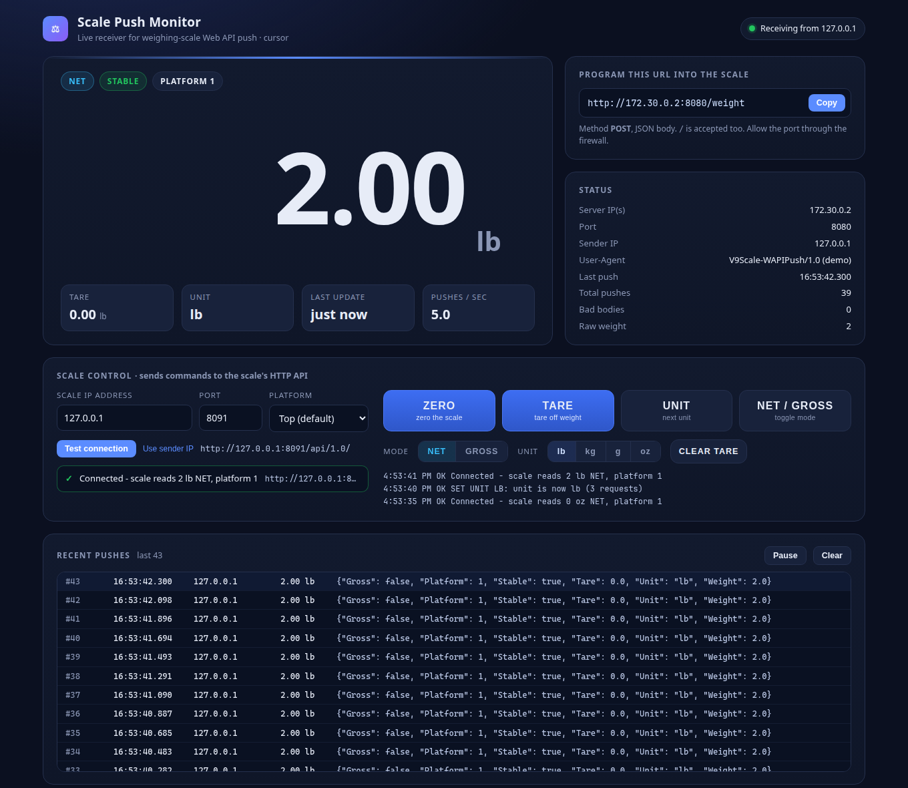

# ScaleAPIMonitor: Web API and REST API test tool for the Arlyn UpScale scale indicator

**ScaleAPIMonitor** is a free, open-source tool from [Arlyn Scales](https://www.arlynscales.com/) for testing and integrating the network API of the [Arlyn UpScale Touchscreen Indicator](https://www.arlynscales.com/scales/arlyn-upscale-touchscreen-indicator-2/). Use it to see live weight data from an Arlyn industrial scale on any PC, to control the scale remotely, and as a working reference when you connect the scale to your own software, MES, ERP or database.

The Arlyn UpScale offers two ways to get weight data over Ethernet or Wi-Fi:

- **Web API Push.** The scale POSTs every reading as JSON to a URL you choose. ScaleAPIMonitor receives these pushes and shows them on a live web dashboard.
- **REST HTTP API.** Your software calls the scale at `http://<scale-ip>:<port>/api/1.0/` to read weight, unit, tare and gross/net, and to press ZERO, TARE, UNIT and NET/GROSS. ScaleAPIMonitor's **Scale control** panel uses this API.



It is a single Python 3 script that uses only the standard library: no `pip install` and no internet access required. It runs on Windows, macOS and Linux.

## Quick start

1. Install **Python 3.8+** from [python.org](https://www.python.org/downloads/). On Windows, tick **"Add python.exe to PATH"**.
2. Download the [latest release](https://github.com/Arlyn-Scales/ScaleAPIMonitor/releases/latest) (or `git clone https://github.com/Arlyn-Scales/ScaleAPIMonitor.git`) and open a terminal in the folder.
3. Start the monitor:

   ```bat
   python scale_push_monitor.py
   ```

   On Windows, you can double-click `run.bat` instead.
4. Open <http://localhost:8080/>.
5. Copy the **push URL** shown on the dashboard (for example `http://192.168.1.50:8080/weight`) into the UpScale's Web API Push settings.
6. To control the scale, enter its IP address and API port in the **Scale control** panel, then press **Test connection**.

No scale handy? Run `python scale_push_monitor.py --demo`. It generates fake pushes and runs a fake UpScale API that responds to the buttons.

On Windows, allow Python through the firewall when Windows asks. Otherwise the scale's pushes can't reach your PC. See [Windows Firewall](docs/user-guide.md#windows-firewall).

## Integrate an Arlyn scale with your own software

Reading the weight from an Arlyn UpScale takes one HTTP request:

```bat
curl http://192.168.1.141:8080/api/1.0/weight
```

```json
{"Gross": false, "Platform": 1, "Tare": 0.0, "Unit": "lb", "Weight": 64.9}
```

The [integration guide](docs/integration-guide.md) has copy-paste examples in Python, C#, JavaScript (Node.js) and PowerShell, both for reading and controlling the scale over the REST API and for receiving Web API Push data in your own server.

## Features

| Area | What you get |
|---|---|
| Live reading | Large weight readout with float32 noise removed (`64.9000015258789` shows as `64.9`); unit, tare and platform; STABLE/UNSTABLE; NET/GROSS badge |
| Connection | This PC's LAN IP(s) and port, the push URL with a copy button, last update, pushes per second, sender IP, User-Agent, and a STALE warning after 3 s without data |
| Push log | The last 50 raw push bodies, with malformed ones highlighted; pause and clear |
| Scale control | ZERO, TARE, CLEAR TARE, UNIT, NET/GROSS, plus direct "set unit" (lb/kg/g/oz) and "set mode" (NET/GROSS), each with its result and a command log |
| Robust input | Accepts `POST /weight` or `POST /`; key names in any case; chunked or form-encoded bodies. Bad JSON is logged but never crashes the server, and the scale always gets HTTP 200 |
| Testing | `simulate.py` (fake pushes, plus an optional mock UpScale API) and the `--demo` flag |

## FAQ

### Does the Arlyn UpScale indicator have a REST API?

Yes. The Arlyn UpScale Touchscreen Indicator has a built-in REST HTTP API (version 1.0) at `http://<scale-ip>:<port>/api/1.0/`. `GET` requests read the weight, unit, tare and gross/net state as JSON, and `POST` requests press the ZERO, TARE, UNIT and GROSS/NET buttons. See the [API reference](docs/api-reference.md#3-arlyn-upscale-rest-http-api-outgoing).

### How do I get weight data from an Arlyn scale into my software?

Over the network, either poll the REST API (`GET /api/1.0/weight`) or turn on Web API Push so the scale sends each reading to your server as JSON. The UpScale also offers RS-232, USB, Keyboard Wedge, Modbus TCP, Modbus RTU/ASCII, EtherNet/IP and PROFINET outputs, live data logging to Google Sheets, and AxChange cloud monitoring. See the [UpScale product page](https://www.arlynscales.com/scales/arlyn-upscale-touchscreen-indicator-2/) for the full list of options.

### What data does Web API Push send?

One HTTP `POST` per reading, with a JSON body such as `{"Gross": false, "Platform": 1, "Stable": true, "Tare": 0.0, "Unit": "oz", "Weight": 64.9}`. The fields are described in the [API reference](docs/api-reference.md#1-web-api-push-from-the-scale-incoming).

### Can I zero or tare an Arlyn scale remotely?

Yes. Send `POST /api/1.0/button/zero/click` or `POST /api/1.0/button/tare/click` to the scale. ScaleAPIMonitor's Scale control panel does this with one click, and also switches units and NET/GROSS mode.

### Is ScaleAPIMonitor free?

Yes. It is open source under the [Apache 2.0 license](LICENSE), so you can use it, change it and build it into your own products.

## Documentation

- [User guide](docs/user-guide.md): installation, setting up the UpScale, a tour of the dashboard, scale control, the simulator, command-line options, firewall and troubleshooting
- [Integration guide](docs/integration-guide.md): code examples for connecting an Arlyn UpScale to your own software
- [API reference](docs/api-reference.md): the Web API Push format, this program's endpoints, and the UpScale REST HTTP API
- [Changelog](CHANGELOG.md)

## Files

| File | Purpose |
|---|---|
| `scale_push_monitor.py` | The server and dashboard (the HTML is built in, so it works offline) |
| `simulate.py` | A fake UpScale: sends pushes, and with `--api-port` also serves a mock UpScale REST API |
| `run.bat` | Windows launcher: double-click it, or run `run.bat 9000` for another port |
| `docs/` | The guides, screenshots and the project website |

## About Arlyn Scales

[Arlyn Scales](https://www.arlynscales.com/) designs and manufactures industrial scales in the USA, including bench, floor, platform and cylinder scales, ArlynGuard intrinsically safe scales, and patented Ultra Precision scales. The [Arlyn UpScale](https://www.arlynscales.com/scales/arlyn-upscale-touchscreen-indicator-2/) is Arlyn's 7-inch color touchscreen indicator for industrial scales, with Ethernet, Wi-Fi, USB, RS-232 and industrial fieldbus connectivity.

For help with the UpScale or its API, or to buy a scale, visit [arlynscales.com](https://www.arlynscales.com/).

## Security note

The dashboard and its scale controls are open to anyone who can reach this PC on the configured port, and there is no login. Run it only on a trusted local network, and don't expose the port to the internet.
