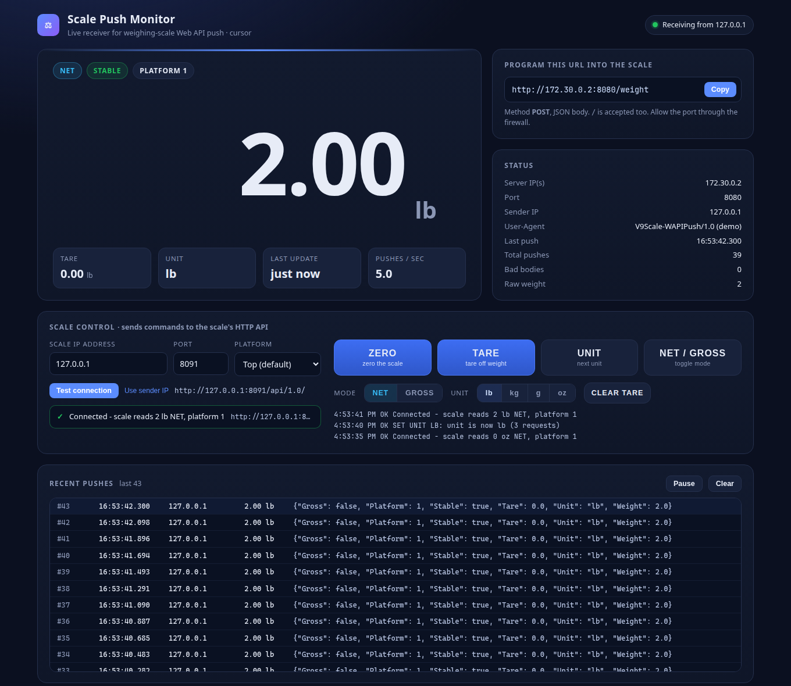

# Test and integrate the Arlyn UpScale REST API

**ScaleAPIMonitor** is a free, open-source tool from [Arlyn Scales](https://www.arlynscales.com/) for the [Arlyn UpScale Touchscreen Indicator](https://www.arlynscales.com/scales/arlyn-upscale-touchscreen-indicator-2/). It shows live weight data from an Arlyn industrial scale on any PC, controls the scale remotely, and gives developers a working reference for connecting the scale to their own software over Ethernet or Wi-Fi.



[Download ScaleAPIMonitor](https://github.com/Arlyn-Scales/ScaleAPIMonitor/releases/latest) · [Source code on GitHub](https://github.com/Arlyn-Scales/ScaleAPIMonitor)

## What you can do with it

- **Watch Web API Push data live.** The UpScale POSTs each reading as JSON to ScaleAPIMonitor, and the dashboard shows the weight, unit, tare, NET/GROSS, stability and platform.
- **Control the scale over the network.** Press ZERO, TARE, CLEAR TARE, UNIT and NET/GROSS from your browser through the UpScale REST HTTP API.
- **Build your own integration.** Copy working examples in Python, C#, JavaScript and PowerShell from the [integration guide](integration-guide.md).
- **Develop without hardware.** A built-in simulator acts like an UpScale, so you can test before the scale arrives.

It is a single Python 3 script with no dependencies, and runs on Windows, macOS and Linux.

## Read an Arlyn scale in one request

```bat
curl http://192.168.1.141:8080/api/1.0/weight
```

```json
{"Gross": false, "Platform": 1, "Tare": 0.0, "Unit": "lb", "Weight": 64.9}
```

## Documentation

- [User guide](user-guide.md): install ScaleAPIMonitor, set up the UpScale's Web API Push, and use the dashboard
- [Integration guide](integration-guide.md): connect an Arlyn UpScale to your own software, with code examples
- [API reference](api-reference.md): the Web API Push format and the UpScale REST HTTP API endpoints

## Frequently asked questions

### Does the Arlyn UpScale indicator have a REST API?

Yes. The Arlyn UpScale Touchscreen Indicator has a built-in REST HTTP API (version 1.0) at `http://<scale-ip>:<port>/api/1.0/`. GET requests read the weight, unit, tare and gross/net state as JSON, and POST requests press the ZERO, TARE, UNIT and GROSS/NET buttons.

### How do I get weight data from an Arlyn scale into my software?

Over the network, either poll the REST API (`GET /api/1.0/weight`) or turn on Web API Push so the scale sends each reading to your server as JSON. The UpScale also offers RS-232, USB, Keyboard Wedge, Modbus TCP, Modbus RTU/ASCII, EtherNet/IP and PROFINET outputs, live data logging to Google Sheets, and AxChange cloud monitoring.

### What data does Web API Push send?

One HTTP POST per reading, with a JSON body containing Weight, Unit, Tare, Gross (true for gross, false for net), Stable and Platform.

### Can I zero or tare an Arlyn scale remotely?

Yes. Send `POST /api/1.0/button/zero/click` or `POST /api/1.0/button/tare/click` to the scale. ScaleAPIMonitor's Scale control panel does this with one click.

### Is ScaleAPIMonitor free?

Yes. It is open source under the Apache 2.0 license, so you can use it, change it and build it into your own products.

## About Arlyn Scales

[Arlyn Scales](https://www.arlynscales.com/) designs and manufactures industrial scales in the USA, including bench, floor, platform and cylinder scales, ArlynGuard intrinsically safe scales, and patented Ultra Precision scales. The [Arlyn UpScale](https://www.arlynscales.com/scales/arlyn-upscale-touchscreen-indicator-2/) is Arlyn's 7-inch color touchscreen indicator for industrial scales, with Ethernet, Wi-Fi, USB, RS-232 and industrial fieldbus connectivity.
