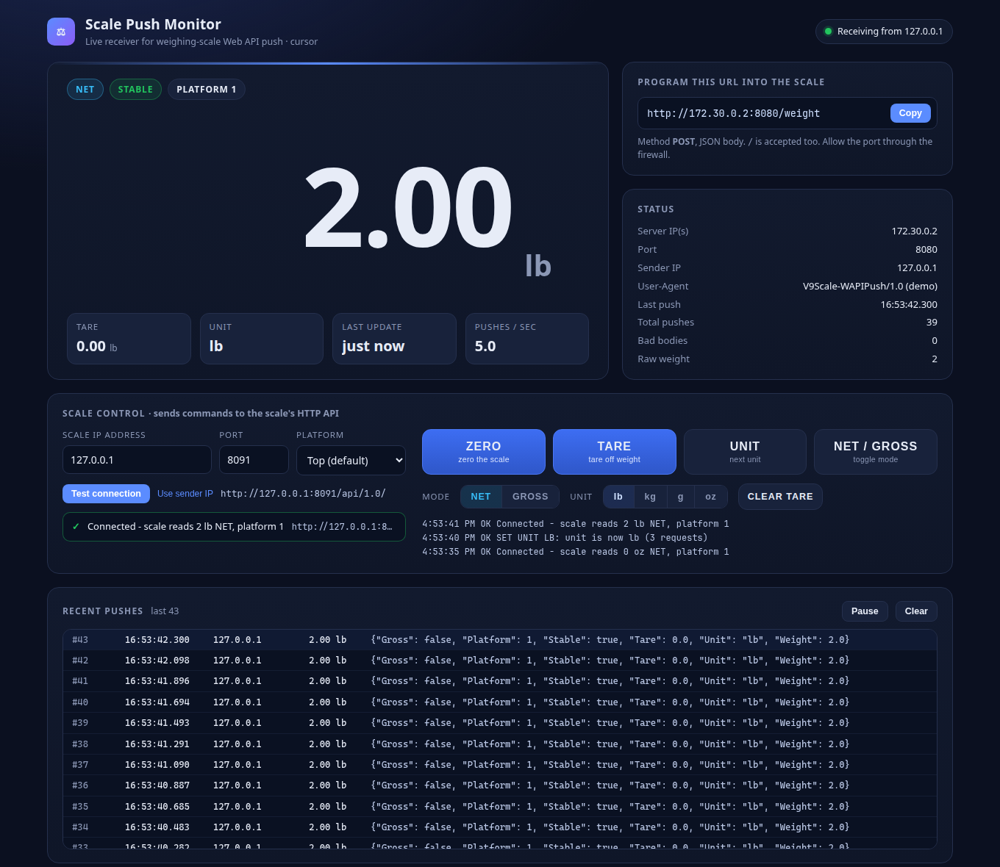
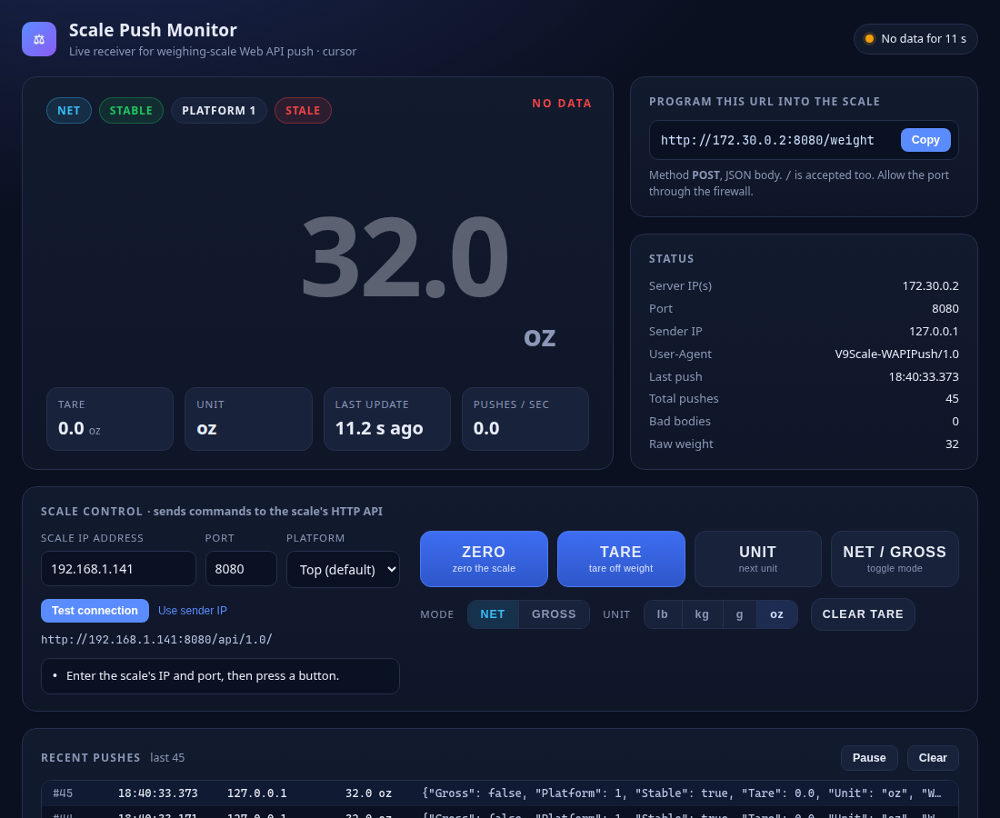

# ScaleAPIMonitor user guide

1. [Install](#install)
2. [Start the monitor](#start-the-monitor)
3. [Point the scale at the monitor](#point-the-scale-at-the-monitor)
4. [Reading the dashboard](#reading-the-dashboard)
5. [Controlling the scale](#controlling-the-scale)
6. [Testing without a scale](#testing-without-a-scale)
7. [Command-line options](#command-line-options)
8. [Windows Firewall](#windows-firewall)
9. [Troubleshooting](#troubleshooting)

---

## Install

You only need **Python 3.8 or newer**. Nothing else gets installed.

- **Windows:** download Python from <https://www.python.org/downloads/>. On the first installer screen, tick **"Add python.exe to PATH"**. Then open a new Command Prompt and check:

  ```bat
  python --version
  ```

  If `python` isn't found, try `py --version`. The Windows launcher `py` works everywhere `python` is used below.
- **macOS / Linux:** use `python3` in place of `python` in the commands below.

Then get the code:

- **ZIP:** on GitHub, click **Code > Download ZIP** and extract it, for example to `C:\Users\<you>\Projects\ScaleAPIMonitor`.
- **Git:** `git clone https://github.com/<your-account>/ScaleAPIMonitor.git`

## Start the monitor

Open a terminal in the project folder and run:

```bat
python scale_push_monitor.py
```

On Windows, you can double-click **`run.bat`** instead. It opens the dashboard in your browser and starts the server.

The console shows where everything is:

```
================================================================
 Scale Push Monitor 1.1
 Listening on 0.0.0.0:8080
 Dashboard : http://localhost:8080/
 Push URL  : http://192.168.1.50:8080/weight   (POST, program this into the scale)
 Press Ctrl+C to stop.
================================================================
```

Open the dashboard at <http://localhost:8080/>. Other devices on the LAN can open it at `http://<this-PC-IP>:8080/`. Press **Ctrl+C** in the console to stop.

To use another port: `python scale_push_monitor.py --port 9000` (or `run.bat 9000`).

## Point the scale at the monitor

1. On the dashboard, find **"Program this URL into the scale"** and click **Copy**.
   If several URLs are listed, use the one on the same network as the scale. For example, a scale at `192.168.1.141` needs a `192.168.1.x` address.
2. In the scale's **Web API / Push** settings, enter that URL. The method is **POST** and the body is JSON.
3. Put something on the scale. The big number should start updating, and the status pill turns green ("Receiving from 192.168.1.141").

Each push also prints a line in the console:

```
#52    14:51:17.120  192.168.1.141   /weight  64.9 oz  tare=0.0  NET  stable  P1
```

Add `-v` to also print the headers and full body of every push.

## Reading the dashboard



**Main reading (top left)**

- **Weight**: the latest pushed value, in large digits. The scale sends 32-bit floats, so `64.9` arrives as `64.9000015258789`. The monitor shows the shortest number that matches, and keeps a fixed number of decimals per unit so the display doesn't jump (for example, lb always shows 2 decimals). Use `--decimals N` to force a fixed number.
- **Badges**:
  - **NET** (blue) or **GROSS** (purple). `"Gross": false` means NET.
  - **STABLE** (green) or **UNSTABLE** (amber; the digits turn yellow too).
  - **PLATFORM n**.
  - **STALE**, which appears when no push has arrived for 3 seconds. The digits also fade and "NO DATA" appears.
- **Tiles**: Tare, Unit, time since the last update, and pushes per second (averaged over 5 s).

**Right column**

- **Program this URL into the scale**: the push URL for each of this PC's LAN addresses, with Copy buttons.
- **Status**: server IP(s) and port, sender IP, the sender's User-Agent (the scale sends `V9Scale-WAPIPush/1.0`), last push time, total pushes, the number of bad bodies, and the unrounded raw weight.

**Status pill (top right)**

| Pill | Meaning |
|---|---|
| Green "Receiving from ..." | Pushes are arriving |
| Amber "Listening - waiting for scale" | The server is running, but no push has arrived yet |
| Amber "No data for N s" | Pushes stopped |
| Red "Dashboard disconnected" | The browser lost contact with the monitor (it reconnects automatically) |

**Recent pushes (bottom)**: the last 50 pushes, newest first, with the time, sender, parsed weight and raw body. Malformed bodies are shown in red with the parse error. Use **Pause** to freeze the list while you read it, and **Clear** to empty it (this only clears the list in your browser).



## Controlling the scale

The **Scale control** panel sends commands to the scale's built-in HTTP API (Arlyn UpScale REST API 1.0), at `http://<scale-ip>:<port>/api/1.0/`.

1. **Scale IP address**: type it in, or click **Use sender IP** to copy the address the pushes come from.
2. **Port**: the scale's HTTP API port, from the scale's network settings. The API documentation's examples use `8080`.
3. **Platform**: leave it on **Top (default)** to act on the platform shown on screen, or choose 1-9.
4. Click **Test connection**. The result box should say, for example, "Connected - scale reads 64.9 oz NET, platform 1".

The IP, port and platform are saved in your browser. To pre-fill them for everyone who opens the dashboard, start the monitor with:

```bat
python scale_push_monitor.py --scale-ip 192.168.1.141 --scale-port 8080
```

### Buttons

| Button | What it does | Request sent to the scale |
|---|---|---|
| **ZERO** | Zeroes the scale | `POST /api/1.0/button/zero/click` |
| **TARE** | Tares off the current weight | `POST /api/1.0/button/tare/click` |
| **CLEAR TARE** | Clears the tare (a long press of TARE) | `POST /api/1.0/button/tare/longclick` |
| **UNIT** | Switches to the next unit | `POST /api/1.0/button/unit/click` |
| **NET / GROSS** | Toggles the mode | `POST /api/1.0/button/gross/click` |
| Mode **NET** / **GROSS** | Switches to that mode | Reads `GET /gross`, clicks only if needed, then checks again |
| Unit **lb / kg / g / oz** | Switches to that unit | Reads `GET /unit` and clicks UNIT until it matches (at most 12 clicks) |

The scale's API can only *toggle* the unit and the mode, so the direct mode and unit buttons read the current state back and click until it matches. If a unit isn't enabled on the scale, the result says so and lists the units the scale cycles through.

The highlighted mode and unit buttons follow the latest push, so you can see the scale's current state at a glance.

Every command shows a result, either a green tick with the HTTP status and time, or a red cross with the reason. It's also added to the command log under the buttons and printed in the console:

```
[cmd]  tare       OK  (from 127.0.0.1)  POST http://192.168.1.141:8080/api/1.0/button/tare/click -> 200
```

**How it works:** browsers don't allow a web page to call another device directly (cross-origin rules), so the dashboard sends each command to the monitor (`POST /api/scale`), and the monitor calls the scale. Only the endpoints in the table above are allowed. See the [API reference](api-reference.md).

You can also test the scale's API without the monitor:

```bat
curl http://192.168.1.141:8080/api/1.0/weight
curl -X POST http://192.168.1.141:8080/api/1.0/button/tare/click
```

## Testing without a scale

**One command:**

```bat
python scale_push_monitor.py --demo
```

This generates 5 fake pushes per second. It also runs a mock scale API on `127.0.0.1:8091` and pre-fills the Scale control panel with that address. The fake load cycles between empty, loading (unstable), loaded (stable) and removed. ZERO, TARE, UNIT and NET/GROSS change the fake readings just like the real buttons.

**Separate simulator** (for example from another PC, to test the network path and the firewall):

```bat
python simulate.py                                        :: 5 pushes/s to http://127.0.0.1:8080/weight
python simulate.py --url http://192.168.1.50:8080/weight  :: push to the monitor across the LAN
python simulate.py --once                                 :: send the captured sample push once
python simulate.py --rate 10 --unit kg --platform 2       :: faster, kg, platform 2
python simulate.py --bad 0.05                             :: 5% malformed bodies
python simulate.py --api-port 8090                        :: also serve a mock scale API (enter its IP / 8090)
```

## Command-line options

### `scale_push_monitor.py`

| Option | Default | Meaning |
|---|---|---|
| `-p`, `--port N` (or just `N`) | `8080` | Port to listen on |
| `--host ADDR` | `0.0.0.0` | Address to bind (`0.0.0.0` = all network interfaces; `127.0.0.1` = this PC only) |
| `--decimals N` | auto | Force N decimals for weight and tare |
| `--scale-ip IP` | (empty) | Pre-fill the scale's IP in Scale control |
| `--scale-port N` | `8080` | Pre-fill the scale's API port |
| `--demo` | off | Fake pushes plus a mock scale API |
| `--demo-rate N` | `5` | Fake pushes per second with `--demo` |
| `--demo-api-port N` | `8091` | Port of the mock scale API with `--demo` |
| `-v`, `--verbose` | off | Print the headers and full body of every push |

### `simulate.py`

| Option | Default | Meaning |
|---|---|---|
| `--url URL` | `http://127.0.0.1:8080/weight` | Where to push |
| `--rate N` | `5` | Pushes per second |
| `--count N` | `0` (forever) | Stop after N pushes |
| `--unit U` | `oz` | Starting unit (`oz`, `lb`, `kg` or `g`) |
| `--platform N` | `1` | Platform number to report |
| `--bad F` | `0` | Fraction of malformed bodies (0-1) |
| `--api-port N` | off | Also serve a mock scale API on this port |
| `-q`, `--quiet` | off | Don't print every push |
| `--once` | | Send the sample push once and exit |

## Windows Firewall

Windows blocks incoming connections by default. The dashboard works on `localhost`, but the scale's pushes never arrive.

- The first time you run the monitor, Windows may ask whether Python can use the network. Tick **Private networks** and click **Allow access**.
- If you missed that prompt, or the network is marked as Public, open **Command Prompt as Administrator** and run:

  ```bat
  netsh advfirewall firewall add rule name="Scale Push Monitor 8080" dir=in action=allow protocol=TCP localport=8080
  ```

  To remove it later:

  ```bat
  netsh advfirewall firewall delete rule name="Scale Push Monitor 8080"
  ```

If you use another port, change `8080` in both commands.

Sending commands to the scale is an *outgoing* connection, so it doesn't need a firewall rule.

## Troubleshooting

| Symptom | What to check |
|---|---|
| "Listening - waiting for scale" never changes | Check that the scale's push URL uses this PC's LAN IP (not `localhost`), the right port, and `/weight`. Check the [firewall](#windows-firewall). Check that the scale and PC are on the same subnet (`ping 192.168.1.141`). Try `simulate.py --url ...` from another PC to separate network problems from scale settings |
| Several IPs listed | Use the one on the scale's network (usually `192.168.1.x`) |
| `ERROR: cannot listen on 0.0.0.0:8080` | Another program is using the port. Use `--port 8081` (and update the scale's push URL) |
| Rows shown in red / "Bad bodies" counting up | The scale sent something that isn't JSON. The raw text is shown in the log and printed to the console. The scale still got HTTP 200 |
| Command: "cannot reach scale: timed out" | Wrong IP, the scale is off, or it's on another subnet. Try `ping <scale-ip>` |
| Command: "Connection refused" | The scale is reachable but not listening on that port. Check its API port and that the HTTP API is enabled |
| Command: "scale replied HTTP 404" | The scale doesn't support that endpoint. Check its API version |
| "unit xx not reachable" | That unit isn't enabled in the scale's unit cycle. Enable it on the scale, or use UNIT to step through the units |
| Dashboard shows "disconnected" | The monitor was stopped or restarted. The page reconnects by itself once it's running again |
| `python` is not recognized | Reinstall Python with "Add to PATH", or use `py scale_push_monitor.py` |
